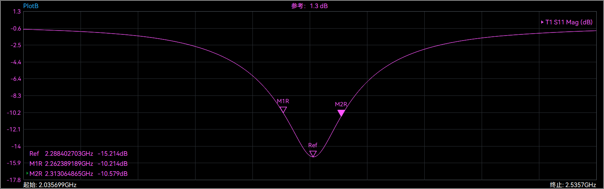
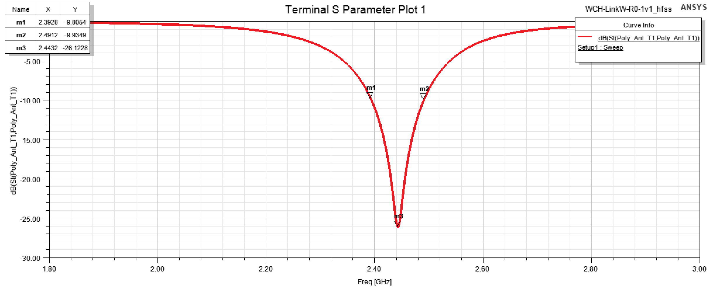
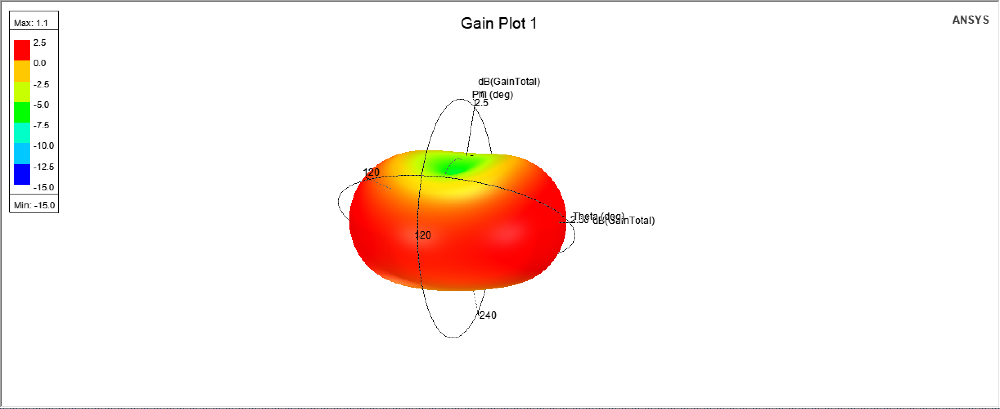

# WCH-Link Debug Tool

&emsp;&emsp;这是一个修改自WCH-Link官方调试工具的WCH-Link项目。最主要的修改是将USB A口更换更加方便的USB C接口。此外WCH-LinkW-R0-1v1的MIFA重新进行了设计，提高了天线带宽，修改了谐振频率不需要Π型网络匹配。

&emsp;&emsp;沁恒官网提供全部4种WCH-Link的原理图和设计固件，这是本本项目的基础，这里很感谢沁恒原厂开发他们的设计。这4种Link工具的区别见下表。

&emsp;&emsp;WCH-Link-R1-1v1是最基础的版本，使用51内核的CH549单片机实现。他功能最简单，RISC-V和ARM的切换需要通过不同固件实现。WCH-DAPLink-R0-2v0是沁恒的DAP-Link工具，所以只支持ARM模式，使用的芯片是CH32V203G8R。

&emsp;&emsp;WCH-LinkW-R0-1v1是无线版本的Link工具，RISC-V和ARM的切换可以通过按键切换。无线使用CH32V208G的蓝牙功能实现，将两个WCH-LinkW-R0-1v1配对。

&emsp;&emsp;WCH-LinkE-R0-1v3是所有Link中性能最强的，支持的芯片最多。特别低，其是唯一一个有带USB HS的。不过调试工具选用的MCU，即CH32V305芯片型号引脚较少，BOOT0功能默认0，导致其ISP功能不能使用。**制做这个工具需要使用其他Link工具烧录。**

# WCH-LinkW-R0-1v1重新设计的天线

&emsp;&emsp;WCH-LinkW-R0-1v1使用的MIFA天线体积虽然小，但是性能不算好。为了减小体积，天线辐射臂线宽很小，导体损耗增加，辐射效率下降，且会导致天线Q值变大。

&emsp;&emsp;下图是去掉匹配网络实测的原厂的S11的矩形图。天线谐振点距离2.44GHz有一定距离，需要额外匹配网络。但是其带宽仅有31MHz，比2.4GHz BlueTooth带宽要小不少。显然原厂的天线设计并不是是很好。本项目优化了原厂的天线设计，S11更好，带宽更大，且谐振点刚好在2.44GHz附近不要Π型网络匹配。

&emsp;&emsp;下图是项目天线的仿真结果。

